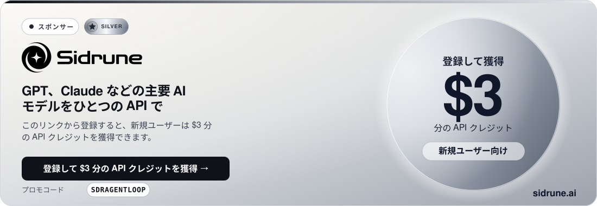
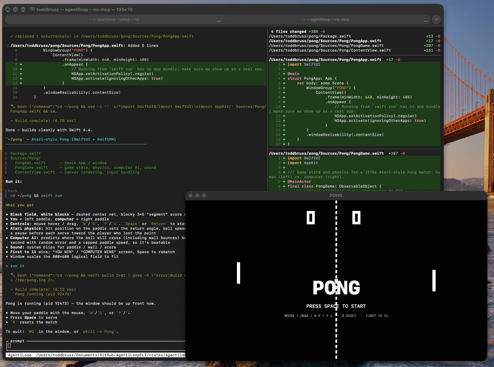
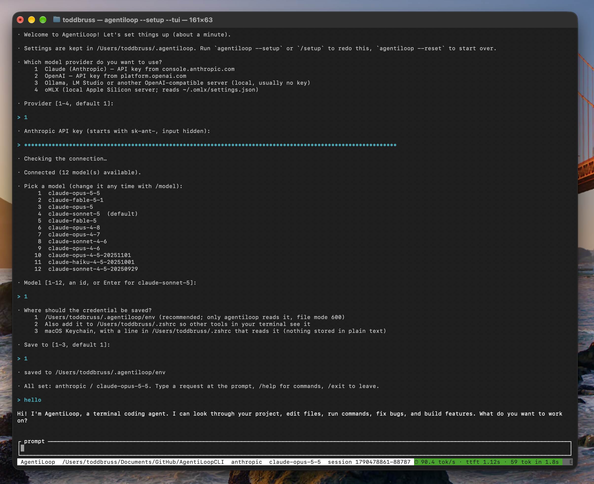

<a href="https://fluxionai.space/register?source=github&campaign=github-sidrune-agentiloop-agent&promo=SDRAGENTLOOP"></a>

# AgentiLoopCLI

🌐 [English](README.md) · [Español](README_es.md) · [Français](README_fr.md) · [Deutsch](README_de.md) · [中文 (简体)](README_zh.md) · [Русский](README_ru.md) · [한국어](README_ko.md) · [日本語](README_ja.md)

### 🎉 Mac、Windows、Linux 向けのリリース版 v0.0.7 を公開しました！

---

**ぜひ試してみてください！** README を読んで、AgentiLoop を動かすまでにどれくらい時間がかかるか確かめてみてください。問題があればお知らせください。皆さんのフィードバックをお待ちしています。

**おまけ:** Go 版もあります: **AgentiLoopGo** → https://github.com/AgentiLoop/AgentiLoopGo

両方試して、どちらが優れているか教えてください: **Rust か Go か？** 🦀 vs 🐹

---

### 💖 AgentiLoop をスポンサーする

気に入っていただけましたか？ AgentiLoop を高速かつクロスプラットフォームに保つためにご支援ください。**[GitHub Sponsors → AgentiLoop](https://github.com/sponsors/AgentiLoop)** でスポンサーになれます。プランと特典は[スポンサーシップガイド](https://github.com/AgentiLoop/Agent/blob/main/docs/SPONSORSHIP.md)に載っています。

[](https://github.com/sponsors/AgentiLoop)

---

AgentiLoop は、Claude Code と同じ発想でターミナル上で動く AI コーディングエージェントです。やりたいことを普通の言葉で伝えるだけです。エージェントがファイルを読み、コードを編集し、コマンドを実行して作業を進めます。何かを変更する前には、必ずあなたの許可を求めます。

Rust で書かれていて、macOS、Linux、Windows で動作します。Claude (Anthropic)、OpenAI、Ollama や LM Studio 経由のローカルモデル、そして Apple Silicon 上の oMLX に対応しています。

AgentiLoop Agent! で作られました。私たちの自慢の子です。macOS、Linux、Windows 向けのビルド済みバイナリは [Releases](https://github.com/AgentiLoop/AgentiLoopCLI/releases) ページにあります。Rust を使ってソースからコンパイルすることもできます。



---

## ⚡ 初回起動: セットアップウィザードがすべてやってくれます

手動で設定するものは何もありません。`agentiloop` を初めて実行すると、組み込みのセットアップウィザードが自動的に起動します。使いたいプロバイダー (Claude、OpenAI、Ollama / LM Studio、または oMLX) を尋ね、API キーを受け取り (入力は隠されます)、キーが動くことを確認し、モデルを選ばせてから、すべてを `~/.agentiloop` に保存します。所要時間は 1 分ほどで、設定ファイルも `export` 行も不要です。



`agentiloop --setup` でいつでも再実行できます (フルスクリーン版にするには `--tui` を追加するか、セッション中に `/setup` と入力します)。`agentiloop --reset` はすべてを忘れて初期状態からやり直します。コマンドラインのプログラムをインストールしたことがありませんか？ 下の[はじめての方へ](#-はじめての方へ-5-分で使い始めましょう)を、順番どおりに進めてください。

---

## 🚀 はじめての方へ: 5 分で使い始めましょう

Rust も Go もコンパイルも不要です。ファイルを 1 つダウンロードし、API キーを設定すれば、すぐにチャットを始められます。手順どおりに進めてください。

### 1. AgentiLoop をダウンロードする

まず、どのファイルが必要かを確認します:

| お使いのコンピューター | ダウンロードするファイル |
|---|---|
| Apple Silicon 搭載の Mac (M1、M2、M3、M4…) | `agentiloop-macos-arm64.tar.gz` |
| Intel チップ搭載の Mac | `agentiloop-macos-x86_64.tar.gz` |
| Linux、64 ビット PC | `agentiloop-linux-x86_64.tar.gz` |
| ARM 上の Linux (Raspberry Pi 4/5、ARM サーバー) | `agentiloop-linux-arm64.tar.gz` |
| Windows 10/11 | `agentiloop-windows-x86_64.zip` |

わからない場合は、Mac または Linux で `uname -m` を実行してください。`arm64` または `aarch64` なら **arm64**、`x86_64` なら **x86_64** です。

**macOS と Linux。** ターミナルを開いて、次の行を貼り付けます。この例は Apple Silicon 用のファイルを使っているので、お使いの環境が違う場合は最初の 3 行の `macos-arm64` を書き換えてください:

```sh
curl -LO https://github.com/AgentiLoop/AgentiLoopCLI/releases/download/v0.0.7/agentiloop-macos-arm64.tar.gz
tar xzf agentiloop-macos-arm64.tar.gz
mkdir -p ~/.local/bin && mv agentiloop-macos-arm64/agentiloop ~/.local/bin/
```

これでプログラムがホームディレクトリ内のフォルダー `~/.local/bin` に置かれます。ステップ 3 のセットアップウィザードが、ターミナルがそこを探すように設定することを提案してくれます。

**Windows。** **PowerShell** を開き (スタートメニュー → 「PowerShell」と入力)、次を貼り付けます:

```powershell
Invoke-WebRequest https://github.com/AgentiLoop/AgentiLoopCLI/releases/download/v0.0.7/agentiloop-windows-x86_64.zip -OutFile agentiloop.zip
Expand-Archive agentiloop.zip -DestinationPath $HOME\agentiloop -Force
$p = [Environment]::GetEnvironmentVariable("Path", "User")
[Environment]::SetEnvironmentVariable("Path", "$p;$HOME\agentiloop\agentiloop-windows-x86_64", "User")
```

最後の 2 行で AgentiLoop を PATH に追加します。変更を反映させるため、**PowerShell を閉じて新しいウィンドウを開いてください**。

### 2. API キーを取得する

AgentiLoop はエージェントです。「頭脳」となるのは、接続する AI モデルです。**1 つ**選んでください:

| 選択肢 | 入手先 | 料金 |
|---|---|---|
| **Claude** (おすすめ) | [console.anthropic.com](https://console.anthropic.com/settings/keys) → *Create Key*。`sk-ant-` で始まります | 従量課金 |
| **OpenAI** | [platform.openai.com/api-keys](https://platform.openai.com/api-keys)。`sk-` で始まります | 従量課金 |
| **Ollama** (自分のコンピューターで動作) | [ollama.com](https://ollama.com) からインストールし、`ollama pull qwen2.5-coder` を実行します | 無料、キー不要 |

キーを安全な場所にコピーしておきましょう。次のステップで貼り付けます。

### 3. セットアップウィザードを実行する

ファイルを編集したり、`export` コマンドを入力したりする必要はありません。AgentiLoop には組み込みのセットアップウィザードがあり、いくつか質問したうえでキーを保存してくれます。

`~/.local/bin` はまだ PATH に入っていないので、今回だけはフルパスで起動します (Windows ではステップ 1 で PATH がすでに設定済みなので、`agentiloop` と入力するだけです):

```sh
~/.local/bin/agentiloop
```

初回、まだキーが設定されていないときは、ウィザードが自動的に起動します。所要時間は 1 分ほどで、次の 5 つを尋ねます:

1. **どのプロバイダーか** — Claude、OpenAI、ローカルの OpenAI 互換サーバー (Ollama、LM Studio、…)、または oMLX。番号を入力します。
2. **API キー** — 入力は隠され、画面には何も表示されません。ローカルサーバーでは通常不要です。同じ Mac 上の oMLX の場合、ウィザードは oMLX 自身の設定からキーを読み込むので、そもそも尋ねられません。
3. **接続確認** — ウィザードはその場でプロバイダーと通信します。キーが間違っていればそう伝えて、再入力を促します。うまくいくまで何も保存されません。
4. **どのモデルか** — プロバイダーが返した一覧から 1 つ選ぶか、Enter を押してデフォルトにします。後から `/model` でいつでも変更できます。
5. **キーの保存先** — Enter を押してデフォルトの `~/.agentiloop/env` にします。これは AgentiLoop だけが読むプライベートなファイルです。(キーをシェルや macOS のキーチェーンにも置きたい人向けの他の選択肢は、クイックスタートの[上級者向け: キーを手動で設定する](#ステップ-2-モデルを接続する)で説明します。)

最後に、ウィザードは `~/.local/bin` が PATH に入っていないことに気づき、追加するかどうか尋ねます。**Enter** (はい) を押してください。その後 `All set` と表示され、プロンプトに入ります。通常のターミナルで Claude を選び、デフォルトを受け入れた場合の一連の流れはこうなります (モデルの一覧はお使いの環境によって異なります):

```text
$ ~/.local/bin/agentiloop
Welcome to AgentiLoop! Let's set things up (about a minute).
Settings are kept in /Users/you/.agentiloop. Run `agentiloop --setup` or `/setup` to redo this, `agentiloop --reset` to start over.

Which model provider do you want to use?
  1  Claude (Anthropic) — API key from console.anthropic.com
  2  OpenAI — API key from platform.openai.com
  3  Ollama, LM Studio or another OpenAI-compatible server (local, usually no key)
  4  oMLX (local Apple Silicon server; reads ~/.omlx/settings.json)
Provider [1-4, default 1]: 1
Anthropic API key (starts with sk-ant-, input hidden):
Checking the connection…
Connected (8 model(s) available).

Pick a model (change it any time with /model):
   1  claude-sonnet-5  (default)
   2  claude-…
   3  claude-…
   …
Model [1-8, an id, or Enter for claude-sonnet-5]:

Where should the credential be saved?
  1  /Users/you/.agentiloop/env (recommended; only agentiloop reads it, file mode 600)
  2  Also add it to /Users/you/.zshrc so other tools in your terminal see it
  3  macOS Keychain, with a line in /Users/you/.zshrc that reads it (nothing stored in plain text)
Save to [1-3, default 1]:
saved to /Users/you/.agentiloop/env

`/Users/you/.local/bin` is not on your PATH, so `agentiloop` only works with its full path.
Add it to PATH in /Users/you/.zshrc? [Y/n]
updated /Users/you/.zshrc (between `# >>> agentiloop >>>` and `# <<< agentiloop <<<`); it applies to new terminals

All set: anthropic / claude-sonnet-5. Type a request at the prompt, /help for commands, /exit to leave.
```

ここでそのままチャットを始めてもいいですし、`/exit` と入力してステップ 4 に進んでもかまいません。以降は `agentiloop` と入力するだけで、そのままプロンプトが開きます。

Claude では、通常の API キー (`sk-ant-api…`) と Claude Code のトークン (`sk-ant-oat01-…`、`claude setup-token` で取得できます) のどちらでも貼り付けられます。AgentiLoop がどちらの種類かを自動で判別します。3 (Ollama、LM Studio、…) を選んだ場合、ウィザードはサーバーの URL も尋ね、デフォルトとして `http://localhost:11434/v1` を提示するので、ローカルの Ollama なら Enter を押すだけです。

**同じウィザードをフルスクリーンで。** ウィザードは使っているインターフェースの中で動きます。`--tui` を付けて起動すると、同じ質問がフルスクリーン画面の中に表示され、終わるとそのままプロンプトに入っています:


**いつでも再実行・やり直しできます:**

```bash
agentiloop --setup          # 通常のターミナルでウィザード
agentiloop --setup --tui    # フルスクリーン TUI の中でウィザード (スクリーンショットのように)
/setup                      # 実行中のセッションの中から (REPL でも TUI でも)
agentiloop --reset          # すべてを忘れて初期状態からやり直す
```

> 🔒 **キーは秘密にしてください。** `~/.agentiloop/env` はあなただけが読めるファイルです。キーをチャットに貼り付けたり、git にコミットしたりしないでください。Mac では、「Where should the credential be saved?」の質問で 3 を選ぶと代わりにキーチェーンに保存されるので、平文でディスクに置かれることはありません。

環境変数を使ってキーを自分で管理したいですか？ それも可能ですが、上級者向けの方法です。クイックスタートの[上級者向け: キーを手動で設定する](#ステップ-2-モデルを接続する)を参照してください。


### 4. 動作を確認する

ウィザードによる PATH の変更を反映させるため、**新しいターミナルウィンドウを開いてください** (Windows では新しい PowerShell ウィンドウ)。そのうえで:

```sh
agentiloop --version
```

`agentiloop 0.0.7` と表示されるはずです。次に、オプションなしで実行します:

```sh
agentiloop
```

そのままプロンプトが開くはずです。代わりにウィザードがもう一度起動した場合は、キーが保存されていません。ステップ 3 をもう一度やり直してください。

### 5. 最初のセッション

プロジェクトフォルダーに移動して、フルスクリーンのインターフェースを起動します:

まずは新しい空のテスト用フォルダーで、安心して試してみましょう。実際のプロジェクトで使うときは、代わりに `cd` でそのプロジェクトのフォルダーに移動してください（例：`cd ~/code/my-app`）。

```sh
mkdir -p ~/agentiloop-test
cd ~/agentiloop-test
agentiloop --tui
```

**Ollama** を使っていますか？ ウィザードがサーバーと選んだモデルをすでに記憶しています。pull 済みの別のモデルに切り替えるには、セッション中に `/model` と入力してください。

あとは、やりたいことを普通の言葉で入力して **Enter** を押すだけです。最初に試すのにおすすめのプロンプト:

```text
このプロジェクトが何をするのか説明して
src 内のファイルを一覧にして、どれがエントリーポイントか教えて
TODO コメントを探して要約して
コマンドラインパーサーに --verbose フラグを追加して
テストを実行して、失敗したものを修正して
このプロジェクトの README.md を作成して
```

エージェントはファイルを変更したりコマンドを実行したりする前に、あなたに確認します。**y** で許可、**n** で拒否、**a** でそのセッション中はそのツールを常に許可、**Esc** でそのステップをスキップします。終了するには **Ctrl-C** を押します。次回からは、`agentiloop` とだけ入力すれば同じ設定で起動し、前回の会話の続きから始まります。

チャットなしで答えを 1 つだけ知りたいですか？ 質問を引数として渡してください:

```sh
agentiloop "explain what this project does"
```

### 何ができますか？ (ツール)

エージェントは 10 個の組み込みツールを使って作業します。自分でツールを呼び出す必要はありません。目的を伝えれば、エージェントがツールを選びます:

| ツール | 機能 | 事前に確認？ |
|---|---|---|
| `read_file` | ファイルを読み込みます (行番号付き) | いいえ |
| `list_dir` | フォルダー内のファイルを一覧表示します | いいえ |
| `glob` | 名前のパターンでファイルを検索します (`*.rs`, `src/**/*.go`) | いいえ |
| `grep` | 正規表現でファイルの中身を検索します | いいえ |
| `web_fetch` | Web ページや API の応答をプレーンテキストで取得します | **はい** |
| `todo_write` | 複数ステップの作業用に、モデル自身のチェックリストを管理します | いいえ |
| `write_file` | 新しいファイルを作成するか、既存のファイルを上書きします | **はい** |
| `edit_file` | ファイル内の特定のテキストを正確に書き換えます | **はい** |
| `bash` | テスト、ビルド、`git` などのシェルコマンドを実行します (Mac/Linux では `sh -c`、Windows では `cmd /C`) | **はい** |
| `task` | 自己完結した作業 (探索、調査) のために、空の会話でサブエージェントを起動し、その答えだけを持ち帰ります。同じツールを持ち、同じように確認します。サブエージェント自身はさらにサブエージェントを起動できません | いいえ (サブエージェントのツール呼び出しは通常どおり確認します) |

Web 検索、データベース、GitHub など、もっとツールが欲しいですか？ MCP サーバーを追加してください。[MCP でツールを追加する](#mcp-でツールを追加する任意)を参照してください。

### ヘルプコマンド

`agentiloop --help` ですべてのオプションが表示されます:

```text
$ agentiloop --help
AgentiLoop — a cross-platform agentic coding loop for your terminal

Usage: agentiloop [OPTIONS] [PROMPT]...

Arguments:
  [PROMPT]...  One-shot prompt. If omitted, starts an interactive REPL. A lone `-` in it is replaced by what is piped on stdin: `git diff | agentiloop "review this" -`

Options:
  -p, --provider <PROVIDER>          Model backend: `anthropic`, `openai` (OpenAI-compatible: OpenAI, Ollama, LM Studio, Groq, OpenRouter, … via OPENAI_BASE_URL), `omlx` (local oMLX server, http://localhost:8000/v1), or `codex` (ChatGPT plan via `codex login`). Defaults to the last one used, then auto-detected from which credentials are set [env: AGENTILOOP_PROVIDER=]
  -m, --model <MODEL>                Model id to use. Defaults to the last model used with this provider (~/.agentiloop/settings.json), then the provider's default [env: AGENTILOOP_MODEL=]
      --yes                          Skip all permission prompts (dangerous; intended for CI). Never remembered [env: AGENTILOOP_YES=]
      --max-turns <MAX_TURNS>        Max provider round-trips per prompt [default: last used, then 50]
      --max-retries <N>              Retries of a provider call that fails transiently (rate limit, overloaded, 5xx, dropped connection) before the error is reported; 0 = never retry [env: AGENTILOOP_MAX_RETRIES=] [default: 3]
      --compact-at <COMPACT_AT>      Summarize the conversation once a request reaches this many input tokens (0 = never) [default: last used, then 80% of the model's context window] [env: AGENTILOOP_COMPACT_AT=]
  -C, --cwd <CWD>                    Working directory the agent operates in (defaults to cwd)
  -r, --resume <RESUME>              Resume a saved session by id (see /sessions)
  -c, --continue                     Resume the most recent session for this working directory (the default for interactive launches; kept for scripts)
      --new                          Start a new session instead of continuing the last one in this directory
      --tui                          Full-screen terminal UI (ratatui) instead of the line REPL. Remembered [env: AGENTILOOP_TUI=]
      --no-tui                       Use the line REPL even if the TUI was used last time
      --no-mcp                       Don't start MCP servers from ~/.agentiloop/mcp.json / ./.mcp.json [env: AGENTILOOP_NO_MCP=]
      --setup                        Run the first-time setup wizard (provider, key, model). Runs by itself on a machine with no credentials and no ~/.agentiloop
      --reset                        Back to brand new: delete ~/.agentiloop (settings, env, history, sessions, mcp.json), the agentiloop block in your shell profile and Keychain items the wizard created. Asks first unless --yes
      --allow-tool <NAME>            Run this tool without asking (repeatable or comma-separated; `mcp_*` matches a prefix)
      --deny-tool <NAME>             Never run this tool; the model is told it was denied (same name rules). Beats --allow-tool and --yes
      --plan                         Plan mode: tools that change something (write_file, edit_file, bash, task, mutating MCP tools) are switched off and the model is asked for a plan instead. Toggle with /plan [env: AGENTILOOP_PLAN=]
      --append-system-prompt <TEXT>  Extra text added to the end of the system prompt for this run (never saved) [env: AGENTILOOP_APPEND_SYSTEM_PROMPT=]
      --json                         One-shot only: print the answer as one JSON object on stdout (result, is_error, session_id, provider, model, usage) instead of streaming text. Tool activity still goes to stderr
      --stream-json                  One-shot only: print every event as one JSON object per line on stdout as it happens (text_delta, text, tool_call, tool_result, turn, compacted, retry, done), then the same result object as --json with "type": "result". Nothing else is printed
  -h, --help                         Print help
  -V, --version                      Print version
```

セッション中に `/help` と入力すると、チャットコマンド (`/model`、`/sessions`、`/resume`、`/clear`、`/compact`、`/mcp`、`/exit`) が表示されます。詳しいリファレンスは[すべてのオプション](#すべてのオプション)と[チャット内のコマンド](#チャット内のコマンド)にあります。

### うまくいかないときは？ すぐできる解決策

| 表示される内容 | 解決策 |
|---|---|
| `command not found: agentiloop` | `~/.local/bin` が PATH に入っていません。まず新しいターミナルウィンドウを開いてください。それでも直らなければ `~/.local/bin/agentiloop --setup` を実行し、PATH に追加するか聞かれたら「はい」と答えてください。Windows では、新しい PowerShell ウィンドウを開いてください |
| `Error: no provider credentials found` | キーが保存されていません。`agentiloop --setup` を実行し (ステップ 3)、ステップ 4 で確認してください |
| macOS: *"agentiloop" cannot be opened* / *unidentified developer* | `curl` ではなくブラウザーでダウンロードした場合に起こります。`xattr -d com.apple.quarantine ~/.local/bin/agentiloop` を実行してください |
| Windows: *Windows protected your PC* | **More info** → **Run anyway** をクリックしてください |
| `401` / `invalid x-api-key` / 認証エラー | キーが間違っているか、スペースや引用符が混ざった状態で貼り付けられています。もう一度コピーして、`agentiloop --setup` を実行して入力し直してください |
| Ollama: model not found | `ollama list` を実行して、正確な名前を `-m` で渡してください |
| 古いモデルやプロバイダーが使われ続ける | 前回の選択を記憶しているためです。`-p` / `-m` を渡して変更するか、`agentiloop --reset` を実行して最初からやり直してください |

それでも解決しない場合は、[Issue を作成](https://github.com/AgentiLoop/AgentiLoopCLI/issues)して、実行したコマンドとエラーを貼り付けてください。私たちがお手伝いします。

---

## クイックスタート

3 つのステップです: インストールして、モデルを設定して、実行します。

### ステップ 1: インストール

**ダウンロード:** [Releases](https://github.com/AgentiLoop/AgentiLoopCLI/releases) からお使いのプラットフォーム用のアーカイブを入手して展開し、`agentiloop` (Windows では `agentiloop.exe`) を PATH の通った場所に置きます。

**またはビルド:** Rust をまだ持っていない場合は、[rustup.rs](https://rustup.rs) からインストールしてください。その後:

```sh
git clone https://github.com/AgentiLoop/AgentiLoopCLI.git
cd AgentiLoopCLI
cargo install --path crates/agentiloop-cli
```

これでプログラムがビルドされ、`agentiloop` コマンドが PATH 上の `~/.cargo/bin` に配置されます。

> **インストールしない場合は？** この README の内容は、すべてリポジトリのフォルダー内からでも使えます。`agentiloop <options>` と書かれている箇所では、代わりに `cargo run -- <options>` と入力してください。`--` より後ろはすべて AgentiLoop に渡されます。

### ステップ 2: モデルを接続する

AgentiLoop には、対話するためのモデルが必要です。**そのために環境変数を設定する必要はありません**: `agentiloop` を実行するだけで、組み込みのセットアップウィザードがいくつか質問して、すべてを保存してくれます。完全な実行例を含むステップバイステップの手順は、上の[3. セットアップウィザードを実行する](#3-セットアップウィザードを実行する)を参照してください。

<details>
<summary><b>上級者向け: キーを手動で設定する</b> (ウィザードでうまくいった場合はスキップしてください)</summary>

キーを自分で管理したい場合や、誰もウィザードに答えられないスクリプトや CI で AgentiLoop を動かす場合は、次の環境変数のいずれかを設定してください。AgentiLoop は何も尋ねずにそれを使います:

| 使いたいもの… | 設定するもの |
|---|---|
| **Claude** (Anthropic) | `export ANTHROPIC_API_KEY=sk-ant-...` |
| **OpenAI** | `export OPENAI_API_KEY=sk-...` |
| **Ollama、LM Studio**、または任意の OpenAI 互換サーバー | `export OPENAI_BASE_URL=http://localhost:11434/v1` (お使いのサーバーのアドレス。ローカルサーバーならキーは不要です) |
| **oMLX** (Apple Silicon 上のローカルモデル) | 通常は何もしなくて大丈夫です。oMLX を起動してから、`-p omlx` を付けて AgentiLoop を実行します |

**oMLX の詳細。** oMLX が同じ Mac で動いている場合、AgentiLoop は oMLX 自身の設定ファイル (`~/.omlx/settings.json`) からサーバーのポートと API キーを読み込みます。oMLX が別のマシンで動いている場合や、その設定を上書きしたい場合は:

```sh
export OMLX_BASE_URL=http://192.168.1.50:7777/v1   # oMLX サーバーのアドレス (localhost なら OMLX_PORT=7777)
export OMLX_API_KEY=...                            # oMLX の設定にある API キー
```

oMLX で API キーの検証がオフになっている場合、キーは不要です。

`export` は、入力したターミナルのタブでしか有効になりません。永続的にするには、その行をシェルプロファイル (macOS では `~/.zshrc`) に追加することになりますが、これはまさにウィザードの **「Also add it to ~/.zshrc」** の選択肢がやってくれることです。同様に、ウィザードの **「macOS Keychain」** の選択肢は、次の手順を自動でやってくれるものです:

```sh
# 一度だけ: キーをキーチェーンに保存します
security add-generic-password -a "$USER" -s ANTHROPIC_API_KEY -w "sk-ant-..."

# ~/.zshrc に記述: 新しいターミナルを開くたびに読み込みます
export ANTHROPIC_API_KEY="$(security find-generic-password -a "$USER" -s ANTHROPIC_API_KEY -w 2>/dev/null)"
```

</details>

### ステップ 3: 実行する

作業したいプロジェクトに移動して、AgentiLoop を起動します:

```sh
cd ~/my-project
agentiloop --tui
```

`--tui` はフルスクリーンのインターフェースを開きます。こちらがおすすめです。やりたいこと、例えば *「設定ファイルを読み込んでいる場所を探して、--verbose フラグを追加して」* と入力し、Enter を押します。

エージェントの返答、使った各ツール (🔧)、各結果 (✓ または ✖) が表示されます。下部のボックスには、今何をしているかが表示されます。例えば ` ✻ Thinking...  12s ` のようにです。ファイルを書き込んだりコマンドを実行したりする前に、あなたに確認します:

- **y**: はい、今回は許可
- **n**: いいえ
- **a**: このセッションの残りの間、このツールを常に許可
- **Esc**: このステップはスキップして、作業は続行

---

## 3 つの使い方

| モード | コマンド | 向いている用途 |
|---|---|---|
| **TUI** (フルスクリーン) | `agentiloop --tui` | 普段使い: 履歴のスクロール、リアルタイムのステータス表示、クリックできるリンク |
| **チャット** (1 行ずつ) | `agentiloop` | シンプルなターミナルや、プレーンテキストが好みの場合 |
| **ワンショット** | `agentiloop "explain this project"` | 1 つの質問: 回答したら終了します。スクリプトで便利です |
| **パイプ** | `git diff \| agentiloop "review this" -` | パイプで渡したテキストがプロンプト中の `-` と置き換わります。diff やログに便利です |

TUI のキー操作: **Enter** で送信 · **↑ / ↓** で以前のプロンプトをたどる · **PgUp / PgDn** またはマウスホイールでスクロール · **Ctrl-F** で*変更ファイル*ペインの表示/非表示（ペイン上のホイールはペインをスクロール、左端をドラッグで幅を変更） · **Esc** で実行中のリクエストを停止（セッションは保持） · **Ctrl-U** で行をクリア · **Ctrl-C** で終了。

---

## @ でファイルを指定する

プロンプトのどこかに `@` に続けてパスを書くと、AgentiLoop はそのファイルをモデルに渡す内容に添付します。`@src/main.rs を説明して` は、あなたの文に加えて行番号付きのファイル本文を送ります。フォルダー (`@src`) なら一覧を添付します。パスはプロジェクトフォルダーからの相対パス (絶対パスや `~/…` も可) です。何も指していない語はそのままなので、メールアドレスも安全です。ファイルは 64 KB、フォルダーは 200 エントリで切り詰められ、📎 の行で何が添付されたかがわかります。TUI、チャット、ワンショットのプロンプトのすべてで使えます。


---

## ! でシェルコマンドを実行する

行の先頭に `!` を付けると、AgentiLoop はその行をモデルに送らず、シェルコマンドとして実行します: `!git status`、`!cargo test`、`!ls src`。出力はすぐに表示され、会話にも追加されるので、続けて「このテストの失敗を直して」と頼めば、モデルはすでにその内容を知っています。コマンドはプロジェクトフォルダで、モデルの `bash` ツールと同じシェル、120 秒のタイムアウト、30 KB の出力上限で実行されます。TUI とチャットで使えます。

---

## # で覚えさせる

行の先頭に `# ` を付けると、AgentiLoop は残りをモデルに送らず、プロジェクトの `AGENTS.md` にメモとして保存します: `# コミット前に必ず cargo fmt を実行する`、`# API クライアントは src/net にある`。メモは `## Notes` 見出しの下に箇条書きで追加されます (ファイルがなければ `/init` のテンプレートから作成され、`CLAUDE.md` があればそちらが使われます)。`AGENTS.md` はシステムプロンプトに入るので、モデルは次のリクエストから、そして以降のすべてのセッションでそのメモに従います。TUI とチャットで使えます。
---

## 設定を記憶します

オプションを入力するのは一度だけです。AgentiLoop は起動時の設定を保存するので、次回からは `agentiloop` とだけ入力すれば同じ設定で起動します:

```sh
agentiloop -p anthropic --tui    # 初回: プロバイダーと TUI を選択
agentiloop                       # 次回以降: 同じプロバイダー、同じモデル、TUI、そして前回の会話
```

記憶される内容:

- **プロバイダー** (`-p`) と **TUI のオン/オフ** (`--tui` / `--no-tui`)
- **モデル**: 最後に使ったモデルを、プロバイダーごとに別々に記憶します。プロバイダーを切り替えて戻ると、そのプロバイダーのモデルも戻ります。
- **上限値**: `--max-turns` と `--compact-at`
- **会話**: 現在のフォルダーでの前回の会話が同じプロバイダーを使っていた場合、その続きから始まります。以前のメッセージが画面に再表示されるので、スクロールして前回どこまで進めたかを確認できます

何かを変更したいときは、新しいオプションを渡してください。すぐに反映され、それ以降も記憶されます:

```sh
agentiloop -p omlx        # oMLX に切り替え (最後に使ったモデルも戻ります)
agentiloop -m <model>     # モデルを切り替え
agentiloop --no-tui       # 1 行ずつのチャットに戻す
agentiloop --new          # 新しい会話を開始 (以前の会話は保存されたまま)
```

いくつかの設定は、意図的に**決して**記憶されません:

- `--yes`: 許可の確認をスキップするのは、毎回意識して選ぶべきことだからです
- `--no-mcp`、`-C`、ワンショットのプロンプト
- API キー: これらは `~/.agentiloop/env` (ウィザードが書き込みます) またはシェルの環境変数に置かれ、`settings.json` には決して保存されません

すべてを忘れさせるには、`agentiloop --reset` を実行してください。

---

## すべてのオプション

すべてのオプションは、2 列目に示した環境変数でも設定できます。入力したオプションは、記憶されている値より常に優先されます。

| オプション | 環境変数 | 機能 |
|---|---|---|
| `-p, --provider <name>` | `AGENTILOOP_PROVIDER` | `anthropic`、`openai`、または `omlx`。指定しない場合、AgentiLoop は前回のものを使うか、キーから自動検出します (Anthropic、次に OpenAI、次に oMLX の順) |
| `-m, --model <id>` | `AGENTILOOP_MODEL` | 使用するモデル |
| `--tui` / `--no-tui` | `AGENTILOOP_TUI` | フルスクリーンのインターフェースのオン / オフ |
| `--new` | | 続きからではなく、新しい会話を開始します |
| `-c, --continue` | | このフォルダーでの前回の会話を続けます (すでにデフォルトの動作です) |
| `-r, --resume <id>` | | 特定の会話を再開します (id は `/sessions` で確認できます) |
| `-C, --cwd <folder>` | | 今いるフォルダーとは別のフォルダーで作業します |
| `--yes` | `AGENTILOOP_YES` | ツールを実行する前に確認しません。⚠️ 信頼できる自動化用途でのみ使ってください |
| `--allow-tool <name>` | | このツールを確認なしで実行します。オプションの繰り返しやカンマ区切りが使えます。`mcp_*` は前方一致です。`--yes` を使わない CI に便利です |
| `--deny-tool <name>` | | このツールを実行しません。モデルには拒否されたと伝わります。`--allow-tool` と `--yes` より優先されます |
| `--plan` | `AGENTILOOP_PLAN` | プランモード: 何かを変更するツール (`write_file`、`edit_file`、`bash`、`task`、読み取り専用でない MCP ツール) をすべてオフにして開始します。モデルは読んで検索したうえで、作業する代わりに番号付きの計画を返します。セッション中は `/plan` でオフ (またはオン) にできます |
| `--no-mcp` | `AGENTILOOP_NO_MCP` | MCP サーバーを起動しません (下記参照) |
| `--append-system-prompt <text>` | `AGENTILOOP_APPEND_SYSTEM_PROMPT` | この実行に限り、システムプロンプトの末尾に追加するテキスト (保存されません) |
| `--json` | | ワンショットのプロンプトで、回答を 1 つの JSON オブジェクト (`result`、`is_error`、`session_id`、`provider`、`model`、`usage`) として stdout に出力します。ツールの動作は stderr に出ます |
| `--stream-json` | | ワンショットのプロンプトで: 各イベントを発生時に 1 行 1 JSON オブジェクトで stdout に出力し (`text_delta`、`text`、`tool_call`、`tool_result`、`turn`、`compacted`、`retry`、`done`)、最後に `--json` と同じ結果オブジェクトを `"type": "result"` 付きで出力します。それ以外は何も出力しません。進捗を見たいエディターやスクリプト向け |
| `--setup` | | 初回セットアップウィザードを再実行します (プロバイダー、キー、モデル)。`--tui` と組み合わせるとフルスクリーン画面の中で実行されます |
| `--reset` | | 初期状態に戻します: `~/.agentiloop`、シェルプロファイル内の agentiloop ブロック、ウィザードが作成したキーチェーン項目（Windows では、ウィザードが設定したユーザー環境変数）を削除します。手書きの `export` 行はコメントアウトされるだけで、しかも同意した場合のみです。`--yes` を付けると確認を省略します |
| `--max-turns <n>` | | 1 回のリクエストでエージェントが実行できる最大ステップ数 (デフォルト 50) |
| `--max-retries <n>` | `AGENTILOOP_MAX_RETRIES` | 一時的な理由 (レート制限、過負荷、サーバーエラー、切断) で失敗したリクエストを、エラーを表示する前に再送する回数。1 秒、2 秒、4 秒… と待って再送します (デフォルト 3、`0` = 再送しない)。各試行は `⟳ retry 1/3` の行で表示されます。回答のストリーミングが始まった後は再送しません |
| `--compact-at <tokens>` | `AGENTILOOP_COMPACT_AT` | 長い会話を要約するタイミング (デフォルト 150000、`0` = しない) |
| `-h` / `-V` | | ヘルプ / バージョン |

いくつかの例:

```sh
agentiloop -p openai -m gpt-4o-mini "summarize this repo"    # 特定のモデルで質問を 1 つ
agentiloop -C ../other-repo --tui                            # 別のプロジェクトで作業
agentiloop --yes "run the tests and fix any failures"        # 無人実行、確認なし
```

**どのモデルが使われますか？** 最初に当てはまるものが優先されます:

1. コマンドラインの `-m`
2. 続きから再開する会話のモデル
3. このプロバイダーで最後に使ったモデル
4. プロバイダーのデフォルト: Anthropic なら `claude-sonnet-5`、OpenAI なら `gpt-4o-mini`、oMLX なら提供される最初のモデル

---

## チャット内のコマンド

TUI またはチャットのプロンプトで、次のコマンドを入力します:

| コマンド | 機能 |
|---|---|
| `!<コマンド>` | シェルコマンドをその場で実行し、出力を会話に追加します ([! でシェルコマンドを実行する](#-でシェルコマンドを実行する) を参照) |
| `# <メモ>` | このプロジェクトの `AGENTS.md` の `## Notes` にメモを保存します ([# で覚えさせる](#-で覚えさせる) を参照) |
| `/model` | 利用可能なモデルを表示します。`/model 3` または `/model <id>` で切り替えます (記憶されます) |
| `/sessions` | 保存された会話を新しい順に一覧表示します |
| `/resume <n or id>` | そのうちの 1 つを再開します |
| `/clear` | 会話をクリアして新しい会話を始めます |
| `/undo` | 直前のプロンプトでエージェントが行ったファイル変更を元に戻します (`bash` コマンドによる変更は戻りません) |
| `/rewind [n]` | プロンプトの一覧を表示するか、プロンプト *n* の前まで戻ります。そのプロンプト以降にエージェントが行ったファイル変更を元に戻し、会話もそこで切り詰めます (`bash` コマンドによる変更は戻りません) |
| `/todos` | モデルの現在のタスクチェックリストを表示します |
| `/diff` | git 作業ツリーの変更を表示します (ステータスと diff、200 行で省略) |
| `/commands` | 独自コマンド: `.agentiloop/commands/<name>.md` (プロジェクト) または `~/.agentiloop/commands/<name>.md` が `/<name>` になり、ファイルの内容がプロンプトとして送られます (`$ARGUMENTS` は後ろに入力した内容に、`$1`〜`$9` は個々の語に置き換わります)。一覧を表示します |
| `/hooks` | `.agentiloop/hooks.json` から読み込んだフックを表示します ([フック](#フック-ツール呼び出しの前後で自分のコマンドを実行する) を参照) |
| `/plan [on\|off]` | プランモードのオン/オフ (引数なしで切り替え)。オンの間は、何かを変更するツールは実行を拒否し、モデルは計画で答えます。TUI のステータス行に **PLAN** と表示されます |
| `/init` | 現在のプロジェクト用に `AGENTS.md` のひな形を作成します (上書きはしません) |
| `/export [file]` | 会話を Markdown ファイルとして保存します (`/export notes.md`、省略時はプロジェクトフォルダーに既定名で保存) |
| `/compact` | 今すぐ会話を要約して容量を空けます |
| `/usage` | 起動後に使用したトークン数と、コンテキストの使用状況を表示します |
| `/status` | 現在の状態: フォルダ、プロバイダー、モデルとその上限、セッション、プランモード、ツール (うち MCP 由来の数)、フック、指示ファイル、設定、トークン使用量 |
| `/mcp` | 接続中の MCP サーバーとそのツールを表示します |
| `/help` | これらのコマンドを一覧表示します |
| `/exit` | 終了します |

---

## 長い会話

モデルが一度に読める量には限りがあります。会話が大きくなると (デフォルトでは、リクエストが 150,000 トークンに達したとき)、AgentiLoop はモデルにそれまでの内容を要約させ、その要約から作業を続けます。そのときは 📦 のメッセージが表示されます。`/compact` で任意のタイミングで要約でき、`--compact-at 0` でこの機能をオフにできます。

**プロンプトキャッシュ (Anthropic)。** Anthropic へのリクエストでは、システムプロンプト、ツール、最新のメッセージをキャッシュ可能として送るので、同じ会話の次のリクエストはプロンプトの大部分を再利用し、改めて支払わずに済みます (キャッシュ部分は約 10 分の 1 のコストで、応答も早く始まります)。設定は不要です。`/usage` でキャッシュから読んだトークン数と書き込んだトークン数がわかり、`--json` では `cache_read_tokens` と `cache_write_tokens` として報告されます。

---

## プロジェクトの指示

プロジェクトに `AGENTS.md` (または `CLAUDE.md`) を置くと、AgentiLoop は起動時にそれを読み込んで従います。ビルドコマンド、コードスタイル、避けるべきことなどを書けます。現在のフォルダーから親フォルダーへ、プロジェクトのルート (`.git` のあるフォルダー) まで探します。個人用の `~/.agentiloop/AGENTS.md` はすべてのプロジェクトに適用され、プロジェクトのファイルはその後に置かれて優先されます。ファイルは 32 KB で切り詰められます。`instructions: <パス>` という行で、読み込まれたファイルがわかります。 `@パス` だけの行 (例: `@docs/style.md`) は、それを書いたファイルからの相対パスで、そのファイルの内容に置き換わります。インポートは 3 階層まで入れ子にできます。存在しないファイル、ループ、コードブロック内の行はそのままです。

---

## フック: ツール呼び出しの前後で自分のコマンドを実行する

フックは、決まったタイミングで AgentiLoop が代わりに実行するシェルコマンドです。ツールの実行前 (`PreToolUse`)、実行後 (`PostToolUse`)、エージェントがリクエストを終えたとき (`Stop`) に動きます。プロジェクトの `.agentiloop/hooks.json`、またはすべてのプロジェクトに効く `~/.agentiloop/hooks.json` に書きます (両方読み込まれます):

```json
{
  "hooks": {
    "PreToolUse":  [{ "matcher": "bash", "command": "sh .agentiloop/check-command.sh" }],
    "PostToolUse": [{ "matcher": "write_file,edit_file", "command": "cargo fmt" }],
    "Stop":        [{ "command": "osascript -e 'display notification \"done\" with title \"AgentiLoop\"'" }]
  }
}
```

- `matcher` は、フックを適用するツールを `--allow-tool` と同じ規則で指定します (名前、`mcp_*` プレフィックス、`*`)。省略するとすべてのツールが対象です。`Stop` フックでは無視されます。
- コマンドはプロジェクトフォルダーで `sh -c` (Windows では `cmd /C`) で実行されます。stdin に JSON オブジェクトが 1 つ渡されます: `event`、`cwd`、`tool`、`input`。`PostToolUse` では `output` と `is_error`、`Stop` では `stop_reason` が加わります。環境変数 `AGENTILOOP_HOOK_EVENT` と `AGENTILOOP_TOOL` も設定されます。
- **終了コード 2 はモデルへのメッセージです。** 終了コード 2 で終わった `PreToolUse` フックは呼び出しをブロックし、stderr に出力した内容がエラーとしてモデルに送られます。`PostToolUse` フックが 2 で終わると、その stderr がツールの結果に追加されます。それ以外の終了コードは無視されます (0 以外はログに残ります)。フックは 60 秒で強制終了されます。
- `/hooks` で読み込まれた内容を一覧できます。壊れたファイルは起動時に報告され、スキップされます。

たとえば、この `PreToolUse` フックは `bash` が `git push` を実行するのを止めます:

```sh
#!/bin/sh
# .agentiloop/check-command.sh — stdin は呼び出しの JSON
if grep -q 'git push' ; then echo "エージェントからの git push は許可されていません" >&2; exit 2; fi
```

---

## MCP でツールを追加する（任意）

[MCP](https://modelcontextprotocol.io) サーバーを使うと、データベースへのアクセス、Web 検索、自作スクリプトなど、エージェントに追加のツールを与えられます。JSON ファイルに一覧を書きます:

- `~/.agentiloop/mcp.json`: すべてのプロジェクトで使えます
- プロジェクトフォルダー内の `.mcp.json`: そのプロジェクトでのみ使えます。両方のファイルに同じ名前がある場合は、こちらが優先されます。

形式は Claude Code、Claude Desktop、Agent! と同じなので、既存の設定をそのままコピーできます:

```json
{ "mcpServers": {
    "Local":  { "command": "my-mcp-server", "args": ["--flag"], "env": { "API_KEY": "${MY_KEY}" } },
    "Remote": { "url": "https://example.com/mcp", "headers": { "Authorization": "Bearer ${TOKEN}" } }
} }
```

仕組み:

- **2 種類のサーバー。** `command` を持つサーバーは、AgentiLoop が代わりに起動するローカルプログラムです。`url` を持つサーバーには HTTP で接続します。新しい「Streamable HTTP」と古い「SSE」のどちらのサーバーにも対応しています。URL が `/sse` で終わる場合 (または `"transport": "sse"` の場合) は古い方式が選ばれます。
- **ツール名。** 各サーバーのツールは、エージェントからは `mcp_<server>_<tool>` という名前で見えます。例: `mcp_Local_search`。
- **シークレット。** `${VAR}` (または `${VAR:-default}`) は環境変数から埋め込まれるので、キーをファイルに書く必要はありません。
- **許可。** MCP ツールも、他のツールと同じように許可を求めます。ただし、サーバーがそのツールを読み取り専用としてマークしている場合は除きます。
- **プロンプト。** サーバーに保存されたプロンプトは `/mcp__<サーバー>__<プロンプト>` というスラッシュコマンドになります (例: `/mcp__Local__summarize 何かのテキスト`)。コマンドの後ろの語がプロンプトの引数に順に入ります (`名前=値` も可)。サーバーが返したテキストがあなたのプロンプトとして送られます。`/mcp` で一覧を確認できます。
- **サーバーをオフにする。** 1 つのサーバーをスキップするには `"disabled": true` を追加し、すべてをスキップするには `--no-mcp` を付けて実行します。
- **安全性。** 暗号化されていない `http://` は localhost でのみ許可されます。リモートサーバーには `https://` が必要です。

`/mcp` と入力すると、接続されたサーバー、そのツール、エラーがあればその内容を確認できます。

---

## 保存場所

すべて `~/.agentiloop/` に保存されます。別のフォルダーを使いたい場合 (例えばテスト用の別プロファイル) は、`AGENTILOOP_HOME` を設定してください。

| ファイル | 内容 |
|---|---|
| `settings.json` | 記憶されたプロバイダー、モデル、オプションに加え、ウィザードが他の場所に書いた内容 |
| `env` | ウィザードが書いたあなたのキー (`KEY=value`、ファイルモード 600)。起動時に読み込まれ、シェルの `export` が優先されます |
| `sessions/` | 会話。1 つの会話につき 1 ファイル |
| `mcp.json` | MCP サーバー |
| `hooks.json` | すべてのプロジェクト用のフック (プロジェクトの `.agentiloop/hooks.json` が追加されます) |
| `history.txt` | 入力したプロンプト (↑ / ↓ 用) |

---

## その他の環境変数

これらが必要になることはめったにありません:

| 変数 | 用途 |
|---|---|
| `ANTHROPIC_BASE_URL` | Anthropic へのリクエストをプロキシや互換サーバーに送ります |
| `ANTHROPIC_OAUTH_TOKEN` | Claude Code のトークン用に、`ANTHROPIC_API_KEY` の代わりに使えます |
| `OMLX_BASE_URL`、`OMLX_PORT`、`OMLX_API_KEY` | oMLX サーバーのアドレスとキー。デフォルトで読み込まれる `~/.omlx/settings.json` より優先されます (どちらも設定されていない場合はポート 8000) |
| `RUST_LOG=debug` | リクエストごとのトークン使用量を含むデバッグログを表示します |

---

## 開発者向け

### ビルドとテスト

```sh
cargo build --release     # → target/release/agentiloop
cargo test --workspace    # オフラインで実行、API キー不要
```

テストはネットワークにアクセスしません。エージェントループはスクリプト化された偽のモデルに対して、ストリーミングパーサーはローカルのテストサーバーに対して実行されます。MCP クライアントは、同梱のサンプルサーバーを使って 3 種類すべての接続方式 (stdio、HTTP、SSE) でテストされます。このサーバーを自分で起動して、手動で MCP を試すこともできます:

```sh
cargo run -p agentiloop-mcp --example mcp-example-server -- --http 8791   # または --sse 8792、または --stdio
```

### コードの構成

プロジェクトは 5 つのクレートに分かれていて、それぞれが前のクレートの上に構築されています:

| クレート | 内容 |
|---|---|
| `agentiloop-core` | 中核部分: エージェントループ、メッセージ、ツールとプロバイダーのインターフェース、許可、セッション、要約 |
| `agentiloop-provider` | モデルとの通信: Anthropic、OpenAI 互換サーバー、oMLX |
| `agentiloop-tools` | 組み込みツール: `read_file`、`write_file`、`edit_file`、`list_dir`、`glob`、`grep`、`web_fetch`、`todo_write`、`bash` |
| `agentiloop-mcp` | MCP クライアント。Agent! の Swift 製 AgentMCP から移植したものです |
| `agentiloop-cli` | `agentiloop` プログラム: オプション、チャット、TUI、設定 |

### 依存関係

依存関係は少なく抑えています: 外部クレートは 18 個で、各クレートは実際に使うものだけを列挙しています。

| クレート | 用途 |
|---|---|
| `tokio`、`futures`、`async-trait` | 並行処理 |
| `serde`、`serde_json` | JSON の読み書き |
| `reqwest` | モデルや MCP サーバーへの HTTP リクエスト |
| `anyhow`、`thiserror` | エラー処理 |
| `tracing`、`tracing-subscriber` | ログ出力 |
| `dirs` | ホームフォルダーの特定 |
| `clap` | コマンドラインオプション |
| `rustyline` | 1 行ずつのチャット |
| `ratatui`、`unicode-width`、`textwrap` | TUI |
| `pulldown-cmark`、`syntect` | Markdown とコードのハイライト |

---

## ロードマップ

- [x] ストリーミング応答
- [x] OpenAI 互換プロバイダー
- [x] 長い会話の要約
- [x] 会話の保存
- [x] フルスクリーン TUI
- [x] MCP クライアント
- [x] フック
- [ ] 次は何でしょう？

## ライセンス

[PolyForm Noncommercial 1.0.0](LICENSE)。このソフトウェアは、個人的かつ非商用の目的であれば、使用、変更、共有することができます。商用バージョンの構築や販売を含む商用利用の権利は AgentiLoop に留保されています。商用ライセンスについては AgentiLoop にお問い合わせください。

---

<a href="https://fluxionai.space/register?source=github&campaign=github-sidrune-agentiloop-agent&promo=SDRAGENTLOOP"></a>

---

**AgentiLoop:** [agentiloop.ai](https://agentiloop.ai/)

Copyright © 2026 AgentiLoop.ai, a Logos InkPen LLC company. All rights reserved.
